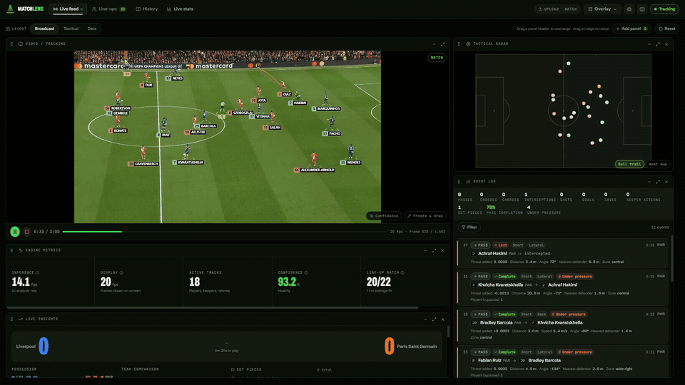
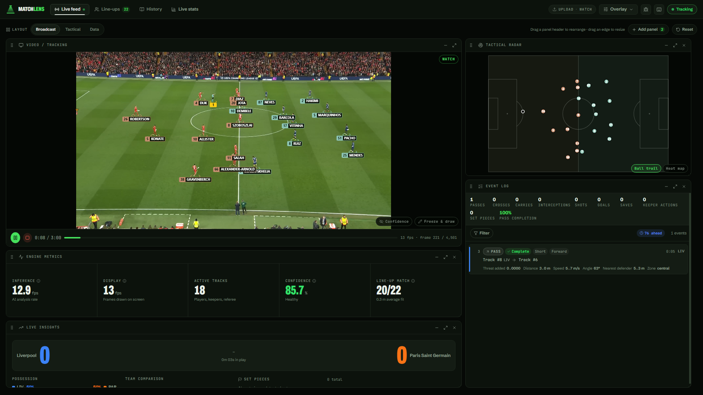
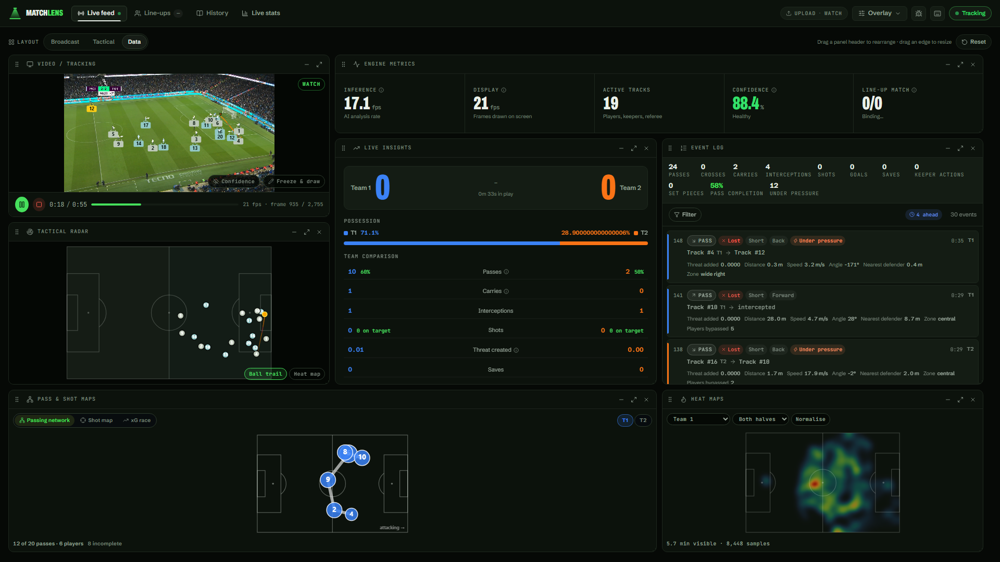
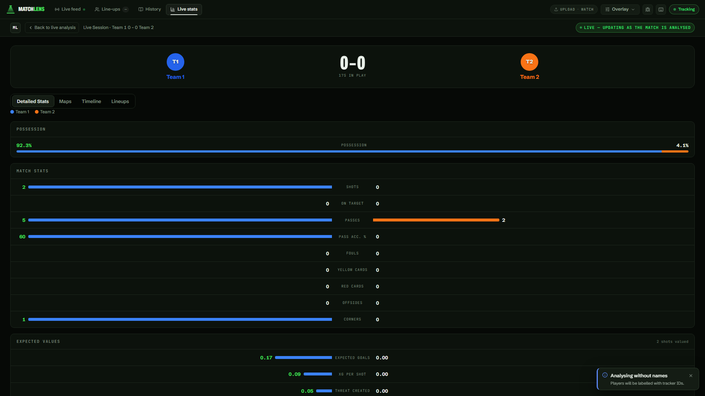
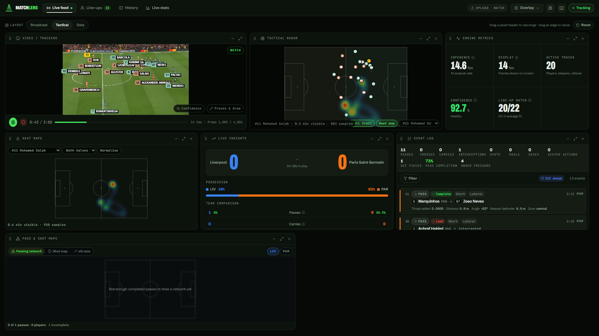
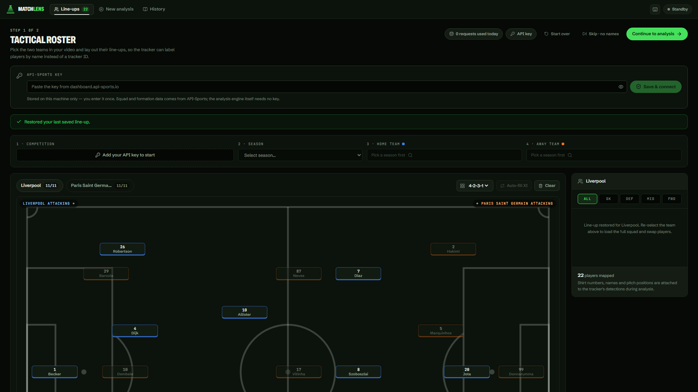
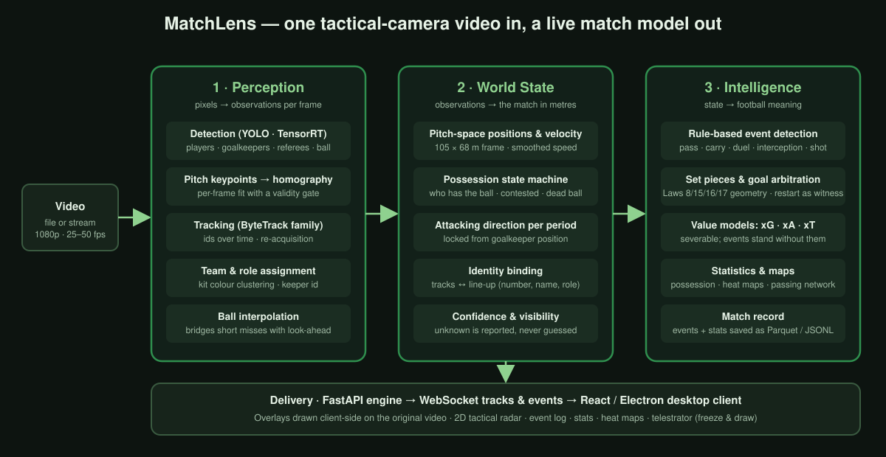

# MatchLens

**A clearer view of the match.** Football video analysis for clubs, coaches and analysts who
do not have a commercial data feed.

MatchLens takes a single tactical-camera recording of a match, as a file or a live stream,
and turns it into a live model of the game: every player and the ball tracked and projected
onto a 2D pitch, possession and attacking direction, a stream of named match events (passes,
carries, duels, interceptions, shots, set pieces, goals), running statistics with expected
goals and threat values, heat maps and passing networks. The analyst watches it in a desktop
app, can pause on any moment, draw on the frame to explain a tactical idea, and reopen the
saved match later. The intended users are coaching staff and analysts at clubs, academies
and amateur teams, working from their own footage.

---

## Demo

  

[Download the MP4 (1080p, 30 s)](assets/demo-realtime-30s.mp4)

Thirty seconds of the live workspace at real-time pace, from the opening minute of a
Champions League tie with both line-ups loaded: tracking with player names, the tactical
radar switching to a player heat map, layout changes, events arriving in the log with the
players' names, and per-player heat maps in the Tactical and Data layouts.

The footage is publicly available broadcast material used here for demonstration only.

---

## Screenshots

| | |
|---|---|
|  | **Live tracking with identity.** Broadcast layout: every player is tracked and labelled with number and name from the loaded line-up (20 of 22 matched); the tactical radar on the right projects the same positions onto the pitch in metres. The event log names both players in a pass. |
|  | **Possession and the event log.** Data layout: the possession bar and team comparison update every second. Each event card carries outcome, distance, speed, angle, nearest defender and threat added; the passing network and team heat map build underneath. |
|  | **Advanced metrics.** The live stats page: shots, passes, corners, and expected values (xG, xG per shot, threat created) computed per action from pitch-space geometry. |
|  | **Tactical layout, per-player heat map.** The heat maps panel and the radar both switch between team and individual player; here the radar overlays one forward's density on the live positions. |
|  | **Line-ups.** Both starting XIs laid out on a pitch board; the tracker binds detections to shirt numbers so events name real players instead of track ids. |

---

## How it works

  

The pipeline changes representation three times. **Perception** turns pixels into
observations: YOLO detection exported to TensorRT, a pitch-keypoint model fitted to a
homography with a validity gate, ByteTrack-family tracking, kit-colour team assignment.
**World State** turns observations into the match in metres: pitch-space positions and
velocity, a possession state machine with hysteresis, the attacking direction locked per
period from the goalkeepers, and tracks bound to a line-up. **Intelligence** turns state into
football meaning: rule-based event detection, set pieces from the Laws' geometry, goals
decided by the restart that follows, severable xG/xA/xT value models, statistics and maps,
all written to a match record. A FastAPI engine streams tracks and events over WebSockets
to a React/Electron client that draws the overlays on the original video.

Details and the reasoning behind the main design choices: [docs/architecture.docx](docs/architecture.docx).

---

## What we evaluated

Every stage is scored against external ground truth: perception on 49 SoccerNet-GSR clips
(36,750 frames, 529,105 annotated objects), event rules on three full matches from two
independent providers (3,791 annotated events). Micro-averaged; weak results included.

| Layer | Metric | Result | Dataset |
|---|---|---|---|
| Detection | player precision / recall | 89.8 % / 78.2 % | SoccerNet-GSR, 49 clips |
| Detection | ball recall | 25.1 % | SoccerNet-GSR |
| Tracking | IDF1 / HOTA | 51.4 % / 44.0 % | SoccerNet-GSR |
| Team / role | accuracy when known | 87.3 % / 95.0 % | SoccerNet-GSR |
| Projection | median error, best clip / pooled | 0.59 m / 2.28 m | SoccerNet-GSR, 15 clips |
| Events | pass F1 | 0.793 / 0.797 | Metrica, 2 full matches |
| Events | throw-in / kick-off / corner F1 | 0.96 / 0.91 / 0.84 | Metrica match 1 |
| Events | shot F1 | 0.43 / 0.35 | Metrica |
| Events | interception F1 | 0.30 / 0.20 | Metrica |
| Possession | frame accuracy; split error | 75–78 %; 0.36–0.65 pp | Metrica, Sportec |

Metric definitions, per-clip spreads, the attribution ladder, test conditions and
limitations: [docs/evaluation.docx](docs/evaluation.docx).

---

## Who built what

Credits are given by role; see [docs/team.docx](docs/team.docx) for what each role implemented,
evaluated and designed.

- **Perception and tracking** — detection model tiers and TensorRT export, pitch keypoints and
  homography gating, tracker integration, team and role assignment.
- **World state and event rules** — pitch-space state, possession state machine, attacking
  direction, rule-based events, set pieces and goal arbitration, value models.
- **Application, delivery and UX** — engine API and streams, the desktop client (layouts,
  radar, event log, heat maps, telestrator), line-up import, saved matches.
- **Evaluation suite and benchmarks** — dataset adapters, scoring rules, pooled reports,
  regression gate.

---

## Status and limitations

**Implemented and working**

- Live tracking with player names from a loaded line-up; three detection tiers; seven
  selectable trackers.
- 2D tactical radar with ball trail and team/player heat-map modes.
- Possession, pass, carry, duel, interception and shot detection; set-piece classification
  with analyst confirm/relabel; goal arbitration by the following restart.
- xG, xA and xT; live statistics; heat maps per team and player; passing network; shot map;
  xG race.
- Telestrator: pause, draw on the frame, save snapshots.
- Saved matches (events, stats, heat maps) reopenable from History; optional annotated video
  export.
- Evaluation suite with regression gate across perception and event layers.

**Known limitations**

- Tactical-camera footage only; broadcast cameras with cuts and zooms are not supported.
- Ball recall and goalkeeper recall are the binding perception defects; shot and interception
  precision the binding event defects (see the evaluation).
- End-to-end accuracy on our own footage is not yet measured, because none of it is
  annotated.
- Event confidence values are poorly calibrated.

**Planned**

- Learned event models alongside the rules; player re-identification across halves;
  annotated tactical-camera benchmark; explainable player ratings, team-performance analysis
  and tactical recommendations; live win probability (proposed in the product brief).

---

## A small runnable example

[`examples/possession_state/`](examples/possession_state/) is a self-contained Python script
that loads a small synthetic tracking CSV, infers possession changes with the same
hysteresis idea the product uses, and plots the timeline. It is labelled as an educational
simplification; the production state machine is larger.

---

## Product brief

[MatchLens-Product-Brief.pdf](MatchLens-Product-Brief.pdf)

---

## Source availability

The MatchLens implementation is maintained in a **private GitLab repository**. This public
repository contains documentation, media, evaluation results and one educational example
only; it does not contain the product source code.
