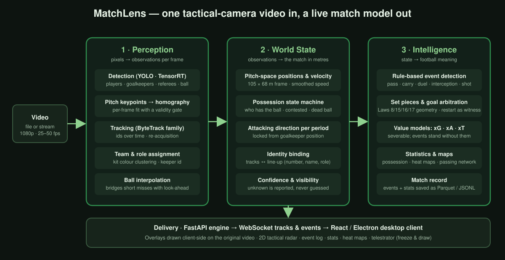

# Architecture

MatchLens is a pipeline that turns one tactical-camera video into a live model of the match.
It is organised as three layers, each of which changes the *representation* of the data:
pixels become observations, observations become a match state in metres, and the state
becomes football meaning. A delivery layer streams the result to a desktop client.

## 1. Perception — pixels to observations

Runs once per frame on the GPU.

| Stage | What it does | Technology |
|---|---|---|
| Detection | Boxes for players, goalkeepers, referees and the ball. Three model tiers (fast / stable / accurate) trade speed for recall. | YOLO, exported to TensorRT with FP16; PyTorch CUDA fallback |
| Pitch keypoints → homography | A keypoint model finds pitch landmarks; a homography is fitted per frame and **gated**: a fit that fails geometric sanity checks is rejected rather than used. | Keypoint model, OpenCV, reprojection checks |
| Tracking | Assigns stable ids across frames and re-acquires lost tracks. Seven trackers are selectable; the default is a tuned ByteTrack variant. | ByteTrack / OC-SORT / BoT-SORT family via BoxMOT |
| Team and role | Kit colours are clustered into two teams; referees and goalkeepers are separated by role. A correction step ("jailbreak") fixes a track that was locked to the wrong team. | colour clustering, role classifier |
| Ball interpolation | Short ball misses are bridged with a bounded look-ahead so possession and passes survive brief occlusions. | engine-side buffer |

Output: an observation frame — every object with pixel box, track id, team, role, confidence.

## 2. World State — observations to the match in metres

| Stage | What it does |
|---|---|
| Pitch-space positions | Image points are projected onto a 105 × 68 m pitch with the frame's homography. Velocity is smoothed per track. |
| Possession state machine | Possession is a **state**, not an event: a player must hold the ball for several frames to gain it, keeps it while a teammate is near the ball, and loses it when nobody is. Contested and dead-ball states exist explicitly. |
| Attacking direction | Decided per period from where each goalkeeper stands, and locked. A direction that is only sampled once early in a half was found to drift, so the lock is tied to the period boundary. |
| Identity binding | When a line-up is loaded, tracks are matched to shirt numbers and names from formation and position cues, so events can name players. |
| Confidence and visibility | Components that do not know (team before colour lock, identity under occlusion) report *unknown* rather than guess. Downstream rules treat unknown as absent, never as false. |

Output: a per-frame game state in metres, plus a possession state and a team-to-side mapping.

## 3. Intelligence — state to football meaning

| Stage | What it does |
|---|---|
| Event detection | **Rule-based**, not learned. Passes, carries, duels, interceptions and shots are derived from possession transitions, ball kinematics and geometry. Each event carries type, team, player, start/end position, outcome and a confidence. |
| Set pieces | Kick-offs, goal kicks, corners, throw-ins and free kicks are recognised from Law 8 / 15 / 16 / 17 geometry (formation at restart, the point where the ball left the field). The analyst can confirm or relabel a set piece from the event log. |
| Goal arbitration | A goal is decided by the **restart that follows** (a kick-off), not by ball geometry at the goal line, which a single camera cannot resolve reliably. |
| Value models | xG per shot, xA for the final pass, xT for progression. These are **severable**: events are complete without them and the models can be swapped. |
| Statistics and maps | Possession share, pass completion, team comparison, heat maps per team and per player, passing network, shot map, xG race. |
| Match record | Events and statistics are written to disk (Parquet + JSONL) every run, so any match can be reopened later without re-analysing. |

## 4. Delivery

A FastAPI engine exposes REST endpoints for session control and two WebSocket streams:
per-frame tracks and events. The React / Electron desktop client plays the original video
locally and draws overlays on top of it, so nothing is re-encoded on the server. A pacing
controller keeps the engine a fraction of a second ahead of playback: the video is nudged
faster or slower rather than paused, which is what makes the live view smooth. A
server-rendered mode exists for producing an annotated video file instead.

The client offers three layouts (Broadcast, Tactical, Data), a 2D tactical radar with ball
trail or heat-map mode, an event log with analyst corrections, live statistics, heat maps,
pass and shot maps, and a telestrator: pause, draw on the frame, save a snapshot.

## 5. Design choices and why

- **Rule-based events instead of a learned event model.** Rules are auditable, need no
  labelled video, and can be benchmarked against event feeds from two independent providers.
  The cost is lower recall on fast transitions (shots, interceptions), which the evaluation
  shows honestly.
- **Overlays drawn on the client.** Server-side encoding of annotated video would cap the
  system at the encoder's speed and double GPU load. Streaming tracks is cheap and lets the
  client stay interactive (pause, draw, change layout) without touching the engine.
- **A homography gate rather than a better homography.** The projection error is bimodal,
  sub-metre on good frames and tens of metres on bad ones. Rejecting a bad fit converts a
  silently wrong coordinate into an honest absent one, which every downstream rule already
  handles.
- **The restart is the witness for a goal.** Ball-in-net geometry from a single tactical camera
  produced wrong decisions; the kick-off that follows a goal is unambiguous.
- **Unknown is not false.** Every abstaining component reports accuracy-when-known, coverage
  and unknown rate separately. This runs through the evaluation suite as well as the product.
- **Two evaluation rigs.** One replays external tracking to isolate rule error; the other runs
  the whole perception stack on annotated footage. See [evaluation.md](evaluation.md).

## 6. Runtime

Reference machine: a laptop with an RTX 3060 (6 GB). On 1080p tactical footage the engine
runs at roughly 25 to 35 fps with the fast detection tier and TensorRT, which is faster than
the 25 fps source, so a match plays in real time. The PyTorch fallback without TensorRT is
two to three times slower.
