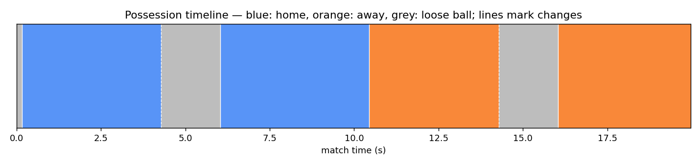

# Possession state on synthetic tracking data

> **Educational example.** This is a deliberately small re-implementation of the *shape* of
> the possession logic in MatchLens so it can be read and run in seconds. The production
> state machine also uses ball and player velocity, an explicit contested/duel state,
> dead-ball detection from set-piece geometry, and confidence/visibility gating. The numbers
> it produces are not the product's.

## What it does

1. Loads `sample_tracking.csv`: 20 s of synthetic play at 25 fps, one row per player per
   frame, with the ball position repeated on each row. Positions are pitch metres with the
   origin at the pitch centre.
2. Infers possession with three rules:
   - the nearest player within **1.5 m** of the ball is the *candidate*;
   - a candidate becomes the *owner* only after **5 consecutive frames** (hysteresis, so a
     pass in flight does not flicker possession between players);
   - the owner keeps the ball while any teammate is within **3 m**; when nobody is, the ball
     is loose and possession is released.
3. Emits possession-change events (gain, loss, turnover) and a possession share.
4. Optionally plots a timeline.

## Run it

```bash
pip install matplotlib            # only needed for --plot
python possession_state.py sample_tracking.csv --plot timeline.png
```

Regenerate the synthetic data with `python make_sample.py` (deterministic).

## Expected output

```
500 frames, 6 possession changes
    0.16s  frame    4  gain      home #8
    4.28s  frame  107  loss      home #8
    6.04s  frame  151  gain      home #10
   10.44s  frame  261  turnover  away #5
   14.28s  frame  357  loss      away #5
   16.04s  frame  401  gain      away #9
possession share: away: 39%, home: 43%, none: 18%
timeline written to timeline.png
```



The scripted sequence is: home #8 carries for 4 s and passes; the ball is loose for ~1.8 s in
flight; home #10 receives and holds; away #5 closes down and wins it at 10.4 s (a turnover,
not just a loss, because the team changed); away #5 carries and passes; away #9 receives at
16 s. Note that each gain is reported five frames (0.2 s) after the ball arrives, which is
the hysteresis cost; the product uses the same trade-off.

## Why hysteresis matters

Without the hold rule, a pass that travels past an opponent would hand possession to that
opponent for a frame or two and back again, producing phantom turnovers and inflating pass
counts. With it, possession only changes when a player has demonstrably controlled the ball.
